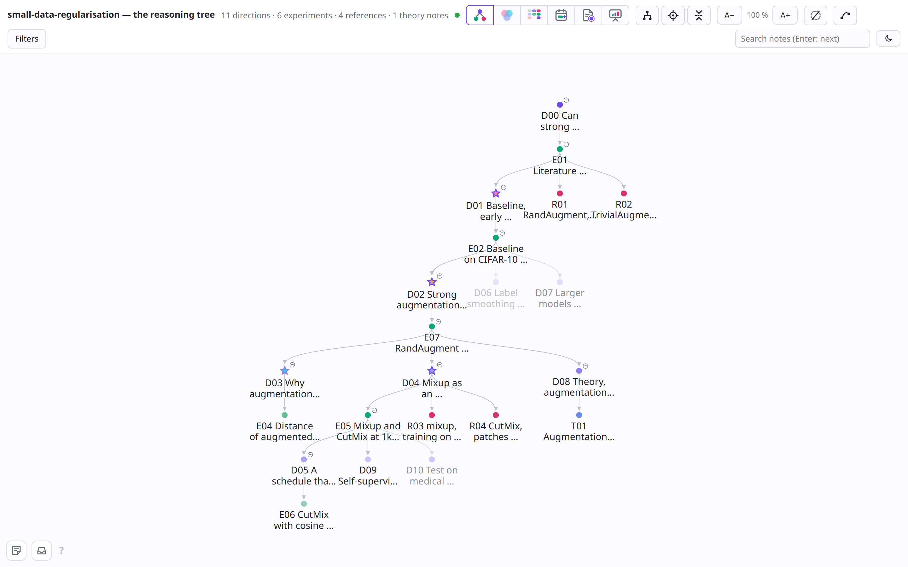

# What rft is

rft (Reasoning Flow Tree) is a plugin for Claude Code that keeps the reasoning of a research
project readable. Every experiment you run and every idea you consider becomes one short note,
each note hangs under the one it came from, and Claude keeps the notes up to date as you work
together. You see the result as a live tree in your browser.

## The idea

Three months into a project, the code and the results are still there, but the reasons are gone:
why this experiment, what it ruled out, which idea was dropped and why. rft writes that down as
it happens, in four kinds of notes.

| Note | Id | What it holds |
|---|---|---|
| **Direction** | `D03` | An idea, a question or a hypothesis, including the ones you rejected. `D00` is the question the project starts from. |
| **Experiment** | `E07` | Something you ran or computed, and what it found. |
| **Reference** | `R02` | A paper or a method you read: what it claims, where to check it, what it means for the project. |
| **Theory** | `T01` | A definition, method or argument of the project's own. |

Each note has a parent, so the notes form a tree: a question leads to an experiment, its result
to two new ideas, one of them to the next experiment. The tree shows what was tried and also why
a path was not taken.

## What you get

- **Claude keeps the tree.** It adds an experiment's note before launching it, records the
  result when it is in, and adds a direction for each new idea. You do not fill in forms.
- **A live view.** The tree in a browser: click a note to read it, filter by tag or status,
  group the notes into lines of research. It follows the notes as they change.
- **Plain files.** The notes are markdown in a folder of your project (`vault/` by default).
  They work in Obsidian, in git and in any editor, and they are the source of truth.
- **More when you want it.** A kanban and a calendar over the same notes, a queue for
  experiments on your GPUs, result pages per line of research, LaTeX documents and slide decks
  built from verified results, and an inbox for papers to read. Each has a page under *Using rft*.

## Where to go next

1. [Install](start/install.md) the plugin: two commands.
2. Take the [first run on the demo](start/first-run.md): about five minutes, nothing to set up.
3. [Activate it in your project](start/activate.md).

rft was created by Gianni Moretti
([GianniMoretti/rft-plugin](https://github.com/GianniMoretti/rft-plugin)). This guide describes
the version developed at [alex-pv01/rft-plugin](https://github.com/alex-pv01/rft-plugin).
