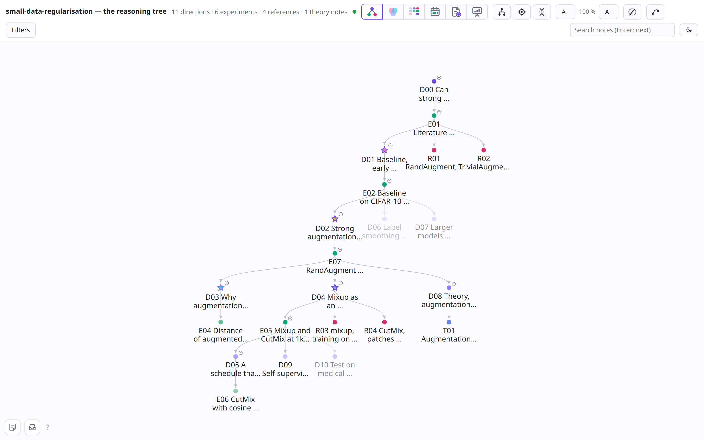
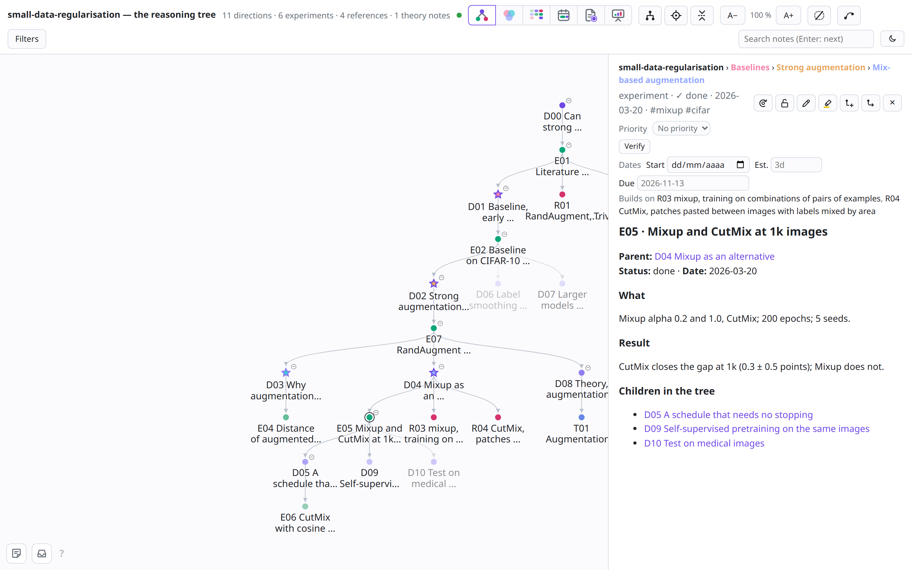
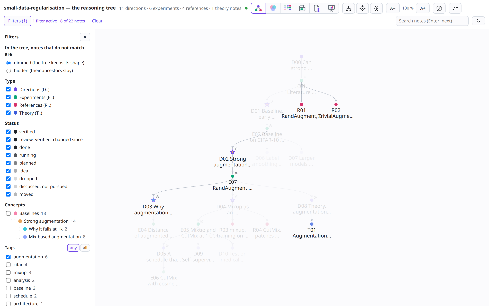
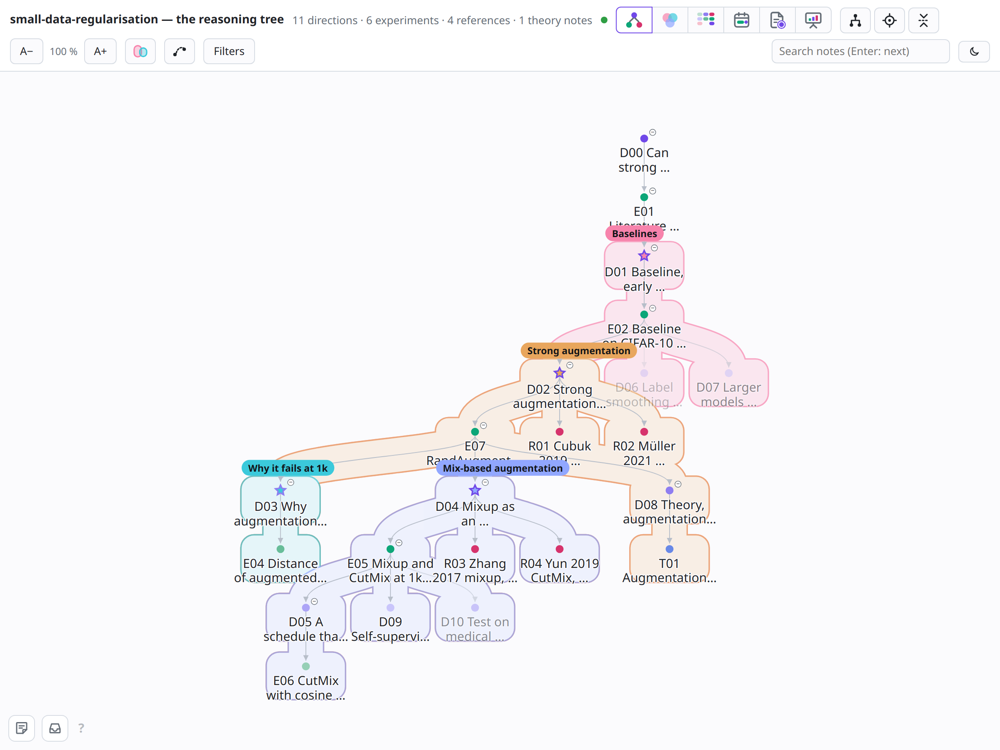
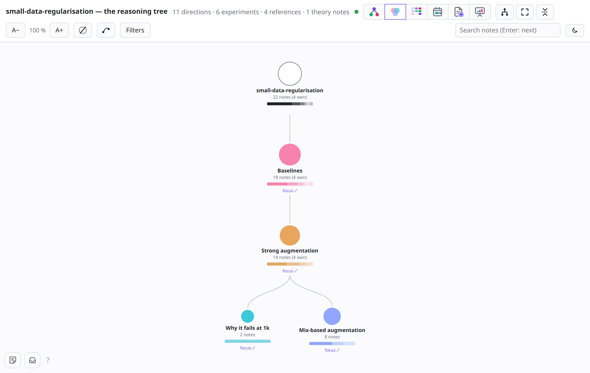

# First run on the demo

The plugin's repository holds a small made-up project, already written as a tree: 22 notes about
whether strong data augmentation can replace early stopping on small datasets. This page opens
it, so you see what rft looks like before you set anything up. It takes about five minutes.

You need the plugin [installed](install.md).

## 1. Get the demo

```bash
git clone https://github.com/alex-pv01/rft-plugin
cd rft-plugin/examples/demo
claude
```

## 2. Open the tree

In the session, type:

```
/rft
```

rft starts a small server on your machine and prints the address of the tree view:

```
Tree view: http://127.0.0.1:41234/?token=…
```

Open that address in a browser on the same machine. (The port and the token are different each
time. In the desktop app, rft first tries to open the view in the app's own browser pane.)



## 3. Look around

Each dot is a note. Its colour says what kind of note it is: violet for a direction, green for
an experiment, pink for a reference, blue for a theory note. The stronger the colour, the
further along the note is. Pale notes are ideas; faded ones were dropped.

Try these, in any order:

- **Click a note** to read it. Its text opens at the right, with its parent, its status and the
  references it builds on.

    

- **Filters** (top left) dims everything that does not match a tag, a type, a status or a date.

    

- **Lines of research.** The demo's notes are grouped into four *concepts*. The overlay button
  in the top bar (a crossed-out circle while it is off) draws them: first as soft regions,
  on the next click as coloured arrows.

    

- **Concepts** (the second button of the top bar) shows the concepts alone, as a tree of their
  own.

    

## 4. Ask Claude about it

Back in the session, the tree is something Claude can read. Try:

```
/rft-next
```

It lists what is still open, by concept, without using the model. Or ask in your own words:
*"Why did we drop label smoothing?"* Claude answers from the notes.

## 5. Stop

```
/rft stop
```

stops the server.

Next: [activate rft in your own project](activate.md).
